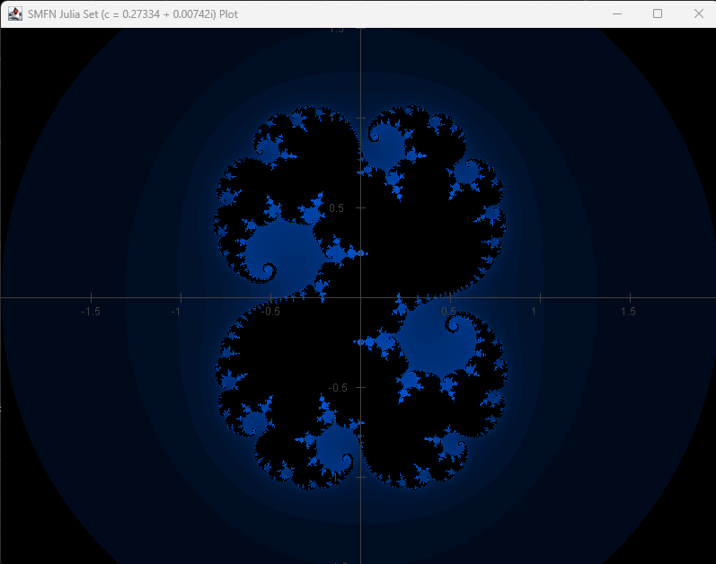
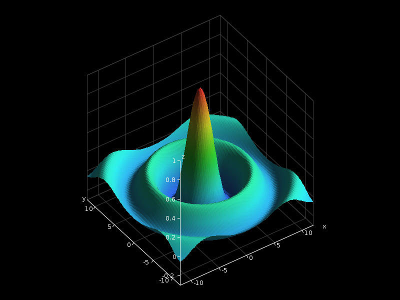

# Graphics Subsystem
The graphics subsystem of `SMFN-library` provides a decoupled visualization framework designed to bridge abstract mathematical models with graphical rendering. The design enforces a strict separation of concerns: mathematical models hold no knowledge of pixels or UI components, and rendering engines hold no knowledge of math.



## Architecture & Decoupling Philosophy
The graphics layer operates across three decoupled tiers:

$$\text{Mathematical Model } f(D) = C \quad\xrightarrow[\text{domainAdapter / colorMapper}]{\text{Viewport}}\quad \text{Plotter Orchestrator} \quad\xrightarrow[\text{Renderer}]{}\quad \text{Concrete Driver}$$

1. **Mathematical Model ($f: D \to C$):** Pure algebraic structures and functions, completely agnostic of pixels, framebuffers, or rendering tech.
2. **Plotter Orchestrator (`graphics.plotting`):** Middle tier that samples mathematical models across coordinate bounds defined by a `Viewport2D`, employing domain adapters and color mappers to translate mathematical values into drawing commands.
3. **Concrete Driver (`graphics.drivers`):** Platform-specific rendering implementation (e.g., AWT/Swing) that executes low-level drawing primitives on screen or image buffers.

### Package Structure
```text
net.gommagomma.smfn.graphics
  +-- core        # Rendering abstractions, primitive contracts, and viewport transformations
  +-- drivers.image # Headless driver on an in-memory image (no window; can save PNG)
  +-- drivers.swing # Concrete desktop AWT/Swing driver implementations
  \-- plotting    # Mathematical plotting orchestrators and coordinate adapters
```

* **`graphics.core`**: Hardware-agnostic interfaces and coordinate space transformations.
* **`graphics.drivers.image`**: A driver that draws on an in-memory image, with no window and no screen needed.
* **`graphics.drivers.swing`**: Desktop AWT/Swing driver implementations. Interchangeable with alternative drivers (e.g., SVG, JavaFX) without affecting mathematical logic.
* **`graphics.plotting`**: Functional orchestrators bridging generic algebraic elements to drawing primitives.


## Core Infrastructure & Rendering Primitives (`graphics.core`)

### Renderer Contracts
A `Renderer` is a drawing surface, and the surface is always a plane of pixels: points, lines, text and fills are traced the same way whether the plotted object is a 1D curve, a 2D scalar field or a projected 3D surface.
The `Renderer` interface defines the low-level API contract required by all plotting orchestrators. It encapsulates frame lifecycle management, state selection, and fundamental drawing primitives across two coordinate regimes:

- **Lifecycle & State:** `startDrawing()`, `endDrawingAndFlush()`, `clear(RgbColor)`, `setColor(RgbColor)`.
- **Viewport-transformed Primitives:** `drawPoint(x, y)`, `drawLine(...)`, `drawText(...)`, `fillPolygon(...)`, `fillRect(...)`.
- **HUD Overlays (Viewport-independent):** `drawOverlayText(...)` for screen-fixed pixel coordinates $[0, w] \times [0, h]$ (bounds, cursor coords, metrics).

### Drivers & Viewport
- **`drivers.image` (`ImageRenderer`)**: Headless `BufferedImage` rendering. Supports direct pixel array access for high-frequency operations, alpha compositing, and optional antialiasing (`setAntialiasing(true)` for lines/text; disabled for fills to prevent edge gaps).
- **`drivers.swing` (`SwingRenderer`)**: Desktop window displaying the underlying `ImageRenderer` buffer.
- **`Viewport2D` & `Viewport3D`**: Manage bidirectional coordinate transformations between continuous math space and discrete screen pixels while preserving aspect ratios. They reject degenerate, inverted or non-finite ranges and non-positive pixel sizes.
- **Controllers (`Viewport2DController` / `Viewport3DController`)**: Turn toolkit-neutral input events into a new viewport and notify the host, without touching math models. In 2D, dragging pans, the wheel zooms around the cursor, and dragging a rectangle with Shift or Ctrl zooms on it; the controller stops zooming before the range gets too small to represent ($10^{-12}$ of the largest coordinate). In 3D, dragging with the primary button rotates, the secondary button (or primary with Shift) pans, and the wheel zooms around the cursor (zoom limited to $[0.1, 20]$). `SwingViewport2DInputAdapter` and `SwingViewport3DInputAdapter` translate Swing mouse events into these calls.


## Plotting Layer (`graphics.plotting`)
The plotting package coordinates sampling and mapping between algebraic objects and rendering primitives.

### 1D Function Plotting (`CurvePlotter`)
`Samples continuous mappings $f(x)$ across a horizontal domain. Non-finite values (poles, domain errors) gracefully interrupt the curve rather than interpolating across gaps.

```java
public static <D extends AlgebraicElement<D>, C extends AlgebraicElement<C>>
void plotFunction(
        Renderer renderer,                     /* Renderer instance */
        Viewport2D viewport,                   /* Viewport defining coordinate mapping */
        Mapping<D, C> function,                /* Mathematical function f(D) = C */
        Function<Double, D> domainAdapter,     /* Domain adapter from double to D (e.g., Double -> Real) */
        Function<C, Double> codomainAdapter)   /* Codomain adapter from C to double (e.g., Real -> Double) */
```

### 2D Function Plotting (`ColorFieldPlotter` & `LevelCurvePlotter`)
- **`ColorFieldPlotter`**: Evaluates $f: D \to C$ across pixel grids using a domain adapter and a `ColorMapper` (ideal for complex functions, fractals, heatmaps).
- **`LevelCurvePlotter`**: Uses marching squares to render contour lines for scalar fields at evenly spaced levels (`LevelCurvePlotter.evenLevels(...)`).

### 3D Surface Plotting (`SurfacePlotter`)
`SurfacePlotter` renders surfaces $z = f(x, y)$ via `Viewport3D` (orthographic projection, adjustable `azimuth`, `elevation`, `zoom`, and offsets). Geometry and color are independent channels ($C = f(D)$ provides height via `heightAdapter` and color via `colorMapper`).



#### Rendering Methods
| Method | Description |
|---|---|
| `plotSurface` | Opaque faces, flat shading (center color), optional lighting. |
| `plotSmoothSurface` | Opaque faces with bilinear vertex color interpolation. |
| `plotWireframe` | Transparent grid wireframe. |
| `plotHiddenLineWireframe` | Opaque wireframe with background-filled cells. |
| `plotLevelCurves` | Solid faces overlaid with constant-$z$ contour lines. |

#### Performance Optimization (`SurfaceGrid`)
For interactive exploration, avoid re-sampling on every frame by caching samples once:
```java
SurfaceGrid<Real> grid = SurfaceGrid.sample(viewport, f, domainAdapter, heightAdapter, 80, 80);
// Redrawn efficiently during rotation/zoom:
SurfacePlotter.plotSmoothSurface(renderer, currentViewport, grid, colorMapper, light);
```
The grid must be sampled on the same box (`minX..maxX`, `minY..maxY`, `minZ..maxZ`) as the viewport it is drawn with; rotation, pan and zoom do not change the box, so one grid serves every frame. Otherwise the plotter throws `IllegalArgumentException`.

#### Lighting, Axes & Space Curves
- **`Light`**: Scales face colors based on surface slope normals (`ambient + (1 - ambient) * max(0, n . L)`). Fixed relative to the scene, not the camera.
- **`SurfaceAxisPlotter`**: `plotWalls(...)` should be called *before* the surface (drawn in the background), while `plotAxes(...)` must be called *after* the surface (drawn on the foreground border with dynamic ticks).
- **`SpacePlotter`**: Renders 3D parametric curves (`plotCurve`) and discrete 3D points (`plotPoints`) as overlays.

#### Quick Setup: Interactive Windows
`SwingWindow.showInteractive` abstracts wiring, input handling, and the render loop: the caller only says *what to draw*, as a function `(renderer, viewport) -> ...` that runs at every redraw (so it must only draw; expensive data, like the `SurfaceGrid`, is computed before). Call it from the event thread (`SwingUtilities.invokeLater`). The window has the pixel size of the viewport.

**3D** (black background, antialiasing on, azimuth/elevation/zoom shown on screen):
```java
Viewport3D initial = new Viewport3D(-12, 12, -12, 12, -0.3, 1.0, 800, 600, 35, 40);
SurfaceGrid<Real> grid = SurfaceGrid.sample(initial, f, Complex::new, Real::getValue, 80, 80);

SwingWindow.showInteractive("sin(r)/r", initial, (renderer, view) -> {
    SurfaceAxisPlotter.plotWalls(renderer, view, RgbColor.DARK_GRAY);
    SurfacePlotter.plotSmoothSurface(renderer, view, grid, colorMapper, light);
    SurfaceAxisPlotter.plotAxes(renderer, view, RgbColor.WHITE, true);
});
```

**2D** (white background, antialiasing off):
```java
Viewport2D initial = new Viewport2D(-2.0, 1.0, -1.5, 1.5, 1600, 1200);

SwingWindow.showInteractive("Mandelbrot", initial, (renderer, view) -> {
    ColorFieldPlotter.plotFunctionParallel(renderer, view, mandelbrot, Complex::new, colorMapper);
    CartesianAxisPlotter.plotAxes(renderer, view, RgbColor.DARK_GRAY, true);
});
```
Both forms have an overload `(..., scene, background, antialiasing)`. For several windows, other input or a different frame loop, the controller and the adapter can be wired by hand.
